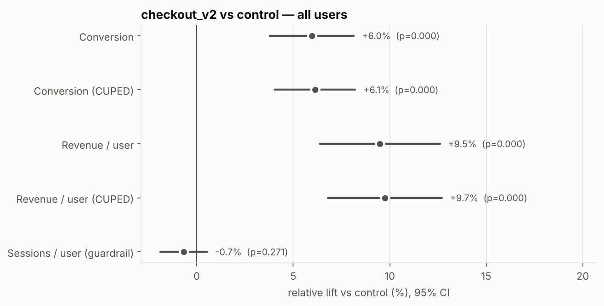
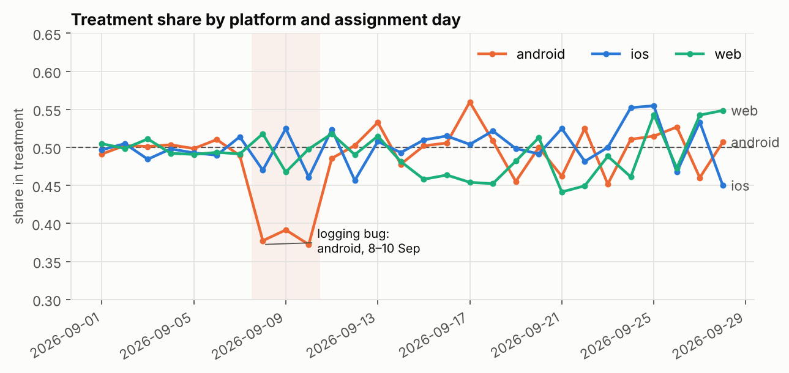
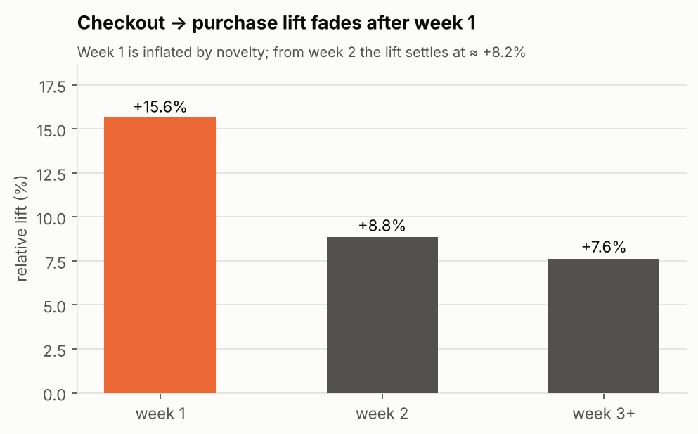
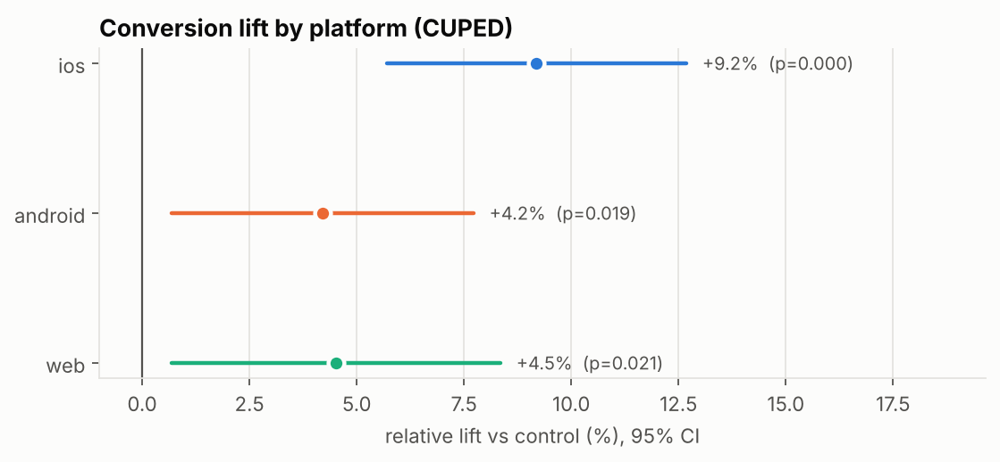

# A/B testing a new checkout — end-to-end in BigQuery SQL

An e-commerce app tests `checkout_v2`, a single-page checkout with express payment,
against the current 3-step flow. The project covers the full lifecycle of an online
experiment: design, data quality checks, analysis in SQL, variance reduction and the
business decision.

> **Result:** `checkout_v2` raises conversion by **+6.1%** (95% CI +4.0% to +8.2%) and
> revenue per user by **+9.7%**, with no harm to engagement. A logging bug (SRM) was
> detected and corrected, and a novelty effect means the long-run lift is about 25%
> lower than the raw result. **Decision: ship, plan on about +4.5% conversion.**
> → [memo.md](memo.md)



## What the analysis does
| Step | Where |
|---|---|
| Pre-registered design: hypothesis, metrics, guardrails, sample size (MDE 3% → 46.5k users/variant) | [design.md](design.md) |
| **Sample Ratio Mismatch** check, plus diagnosis of the root cause by platform × day | [sql/01_srm_check.sql](sql/01_srm_check.sql) |
| Per-user metric table from 4 raw tables: post-assignment window, pre-period covariates | [sql/02_user_metrics.sql](sql/02_user_metrics.sql) |
| Welch z-tests, 95% CIs, **CUPED** variance reduction, platform segments with Bonferroni | [sql/03_ab_results.sql](sql/03_ab_results.sql) |
| **Novelty effect**: lift by week since assignment | [sql/04_novelty.sql](sql/04_novelty.sql) |
| Figures | [analysis.ipynb](analysis.ipynb) |
| Decision memo for stakeholders | [memo.md](memo.md) |

All statistics are computed in BigQuery SQL. Python is used only to generate the data
and draw the charts.

## Key findings
**1. The randomisation was broken, and the cause was localised.** The treatment group
had fewer users than expected (χ² = 10.7, p = 0.001). Breaking the split down by
platform and day isolates android users on 8–10 September, a logging bug. That cell is
removed from both variants.



**2. The lift is real but inflated at first.** The checkout → purchase lift is +15.6%
in week 1 and settles at about +8% afterwards.



**3. iOS drives the effect.** Android and web are positive but not significant after
multiple-testing correction.



## Data
The data is **simulated** with [generate_data.py](generate_data.py): 100k users,
1.3M sessions, 2.6M events and 67k orders across 5 relational tables, with a 28-day
pre-period and a 28-day experiment. Because known effects were injected, the analysis
can be **validated against the ground truth**:

| Injected in the data | Recovered by the analysis |
|---|---|
| Assignment logging bug, android treatment, 8–10 Sep | SRM p = 0.001, localised to exactly those cells |
| Lift +7% on iOS and android, +1% on web | iOS strongest (+9.2%); android (+4.2%) and web (+4.5%) can't be told apart at this sample size. Segment estimates are noisy, which is why they are treated as exploratory |
| Novelty boost decaying over a few days | week-1 lift ≈ 2× later weeks |
| No effect on engagement | sessions/user not significant |

```
users ──< assignments        (experiment_id, variant, assigned_ts)
  │──< sessions ──< events   (session_start → product_view → add_to_cart → checkout_start → purchase)
  └──< orders                (revenue_eur)
```

## Reproduce
```bash
pip install pandas numpy pyarrow
python generate_data.py              # writes data/*.parquet
```
1. In BigQuery, create dataset `ab_test` (EU) and load the 5 files as tables of the same name.
2. Run `sql/01` → `sql/04` in order.
3. Open `analysis.ipynb` (`pip install google-cloud-bigquery db-dtypes matplotlib`,
   then `gcloud auth application-default login`).

## Limitations and next steps
- Simulated data: the value is in the method, not in the numbers.
- The novelty analysis is session-level. Sessions of the same user are correlated, so
  it is used for the trend only, not for inference.
- Natural extensions: the delta method for ratio metrics (e.g. AOV), sequential
  testing for early stopping, and a long-term holdout.
